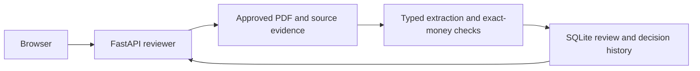

# InvoiceMatch

InvoiceMatch is an accounts-payable review app for synthetic invoice PDFs. Choose a purchase order, inspect line-level findings with source excerpts, and save a review decision with an audit history.

**Status** — Phase 1 local workflow in review. The rules-based reviewer and bundled demo samples run locally. The model benchmark and public deployment are later phases.

The benchmark will measure whether model-assisted extraction catches more discrepancies than rules-only extraction and how that affects review volume, latency, and cost. Both extractors will use the same invoice evidence, return the same typed record, and run through the same deterministic reconciliation rules.

## Run the local reviewer

```shell
docker compose up --build
```

Open [the local reviewer](http://127.0.0.1:8000/). Download a sample PDF from the page, choose `PO-001`, and upload the sample. Submit the clean sample twice to exercise duplicate handling. After saving a decision, reload the review page to see the history.

Compose binds to loopback and stores reviews in a named volume. Use `INVOICEMATCH_PORT` to select a different host port. To run with an installed package instead, use `python -m uvicorn invoicematch.app:create_app --factory`.

The local workflow accepts the three bundled synthetic invoice files. It bounds request size and upload time. The input format is positioned invoice text with recognizable table headings. A table or field the system cannot verify goes to review.



## Verify the local workflow

In an activated Python 3.11+ virtual environment, run:

```shell
python -m pip install -e ".[dev]"
python -m pytest
python -m ruff check .
python -m ruff format --check .
python -m mypy src
```

Use `docker compose build` to verify the image. The test suite checks the matching policy, source row evidence, API boundaries, session isolation, and concurrent retries through the upload endpoint.

The sample generator runs with `python scripts/generate_demo_fixtures.py`. It produces the clean-match, price-mismatch, and ambiguous-extraction PDFs. The duplicate scenario reuses the clean-match bytes.

## First release

The app compares one digitally generated, allowlisted synthetic INR invoice against one seeded purchase order. It checks supplier identity, line IDs, quantities, unit prices, line extensions, invoice total, and currency. Values use exact decimal arithmetic. A reviewer sees expected and observed values, the source page and excerpt when available, and any evidence the system could not establish.

The tagged public release must provide an HTTPS UI that works in a fresh browser without credentials. Visitors can upload a provided sample, select its purchase order, run a comparison, inspect the result, and record a decision. The UI exposes four labeled fixture-replay scenarios and live model extraction on at least one approved sample. Decisions survive reload, sessions are isolated, and live mode has a server-side request budget and explicit failure feedback.

The release scope is full-order reconciliation with digitally generated synthetic invoices. The workflow ends at a saved review decision.

## Phases

| Phase | Exit evidence |
| --- | --- |
| 0. GitHub and design | Verify the dedicated public repository and committed docs. Freeze the decisions, fixtures, comparison criteria, proposed data model, and verification commands below. Obtain approval for the first implementation plan. |
| 1. Deterministic workflow | Run all four seeded cases through the local reviewer UI. Pass exact-money, evidence, persistence, isolation, and concurrent retry checks. Verify the one-command local run. |
| 2. Model comparison | Run a paired benchmark on held-out layouts, publish measured outcomes, and verify provider failures. Run replay tests in CI without provider credentials. |
| 3. Public release | Tag and deploy the tested revision. Verify all four replay cases, a real provider-backed review, persisted decisions, session isolation, and live limits from the hosted app. Verify clean-clone instructions, CI, and deployment and rollback documentation. |
| 4. Maintenance release | Reproduce a defect, add a regression test, deploy a tagged fix, and verify the hosted workflow and recovery path. |

The independent Scrutiny agent reviews the exact candidate revision at each phase gate. A phase advances after required checks pass, material findings are resolved, and the verdict is recorded with the revision and evidence.

## Phase 0 design

### Matching policy and fixture outcomes

The reference order is `PO-001` from supplier `SUP-001`, in INR. It has item `A-10` (10 × ₹100.00) and item `B-20` (2 × ₹50.00), for a total of ₹1,100.00. Order lines have unique IDs. In-scope invoice quantities are positive integers and monetary fields are nonnegative amounts with at most two decimal places. A match requires a grounded invoice number and supplier ID, and one instance of every order line with matching quantity, price, and currency. Check each displayed line total against its own quantity × unit price and the displayed invoice total against the sum of the computed line totals.

| Case | Labeled input | Expected behavior |
| --- | --- | --- |
| Clean match | Invoice `INV-DEMO-01` identifies `SUP-001`, both reference lines, and the ₹1,100.00 total. | Match with cited source evidence. |
| Unit price mismatch | `A-10` is ₹120.00 per unit, with consistent line and invoice totals of ₹1,200.00 and ₹1,300.00 respectively. | Mismatch showing ₹100.00 expected and ₹120.00 observed for the unit price. |
| Quantity or line-set mismatch | A complete, readable table establishes a different quantity, an extra line, or an omitted order line. | Mismatch showing the affected line ID and expected and observed values. |
| Other grounded mismatch | The source proves a different supplier or a displayed total that disagrees with the available line arithmetic. | Mismatch with the relevant supplier or arithmetic finding. |
| Ambiguous or malformed extraction | A required field is missing, two values conflict, a line ID repeats, the extracted price came from another row, or the extraction response is malformed. | Needs review. Cite what can be verified and identify the missing or invalid evidence. |
| Identical retry | The same PDF bytes, order, session, and mode are submitted twice, including simultaneously. | Return the same review ID. Persist one review and preserve its saved decision. |
| Possible duplicate | A second PDF has different bytes but the same verified supplier ID and invoice number in the same session. | Needs review with a possible duplicate finding. Preserve both submissions. |
| Conflicting order selection | The same PDF is paired with a different known order in the same session. | Needs review on the new submission. Preserve the original decision and show both order IDs. |
| Input boundaries | Unsupported currency, a valid PDF with unreadable text, malformed PDF bytes, an oversized upload, or an unknown order. | Route unsupported currency and unreadable text to review. Reject malformed PDFs, oversized uploads, and unknown orders before reconciliation. |
| Provider failure | A live extraction call times out or returns an error. | Needs review with a provider failure reason. An exhausted budget prevents the call and shows live mode as unavailable. |

Validate input boundaries before creating review records for the submission. Reuse an existing exact retry before classifying a new submission. For new items, uncertain evidence or a possible duplicate or order conflict takes precedence over a match or mismatch. A source pass identifies the table boundaries and row spans from PDF text positions independently of either extractor. Verify coverage of every source row and ground material values in their row or header. A missing field in incomplete extraction is uncertainty. A line absent from a verified complete table is a discrepancy. Treat unprovable table completeness as uncertainty.

### Proposed data model and write behavior

| Record | Proposed fields and constraints |
| --- | --- |
| Purchase order and lines | Order ID, supplier ID, currency, exact monetary values, and line IDs unique within the order. |
| Extraction | Invoice number, supplier ID, currency, totals, and typed lines. Material fields carry a page reference and row or header evidence. |
| Review | Session, PDF SHA-256, order ID, mode, extraction result, verdict, and findings. The session, hash, order, and mode form a unique key. Same-document order conflicts and grounded invoice identity collisions are looked up within the session. |
| Decision event | Review ID, decision, optional note, and timestamp. Append the event and any reviewer state change in the same transaction. |

Use SQLite with a database uniqueness constraint to make retries safe under concurrency. Run extraction outside the write transaction. Use a bounded wait to acquire the write lock before rereading the retry key, checking for other conflicts, and inserting the review. Resolve a uniqueness conflict by loading the winning review. Store monetary values without binary floating-point conversion. Partition public reads and writes by the current server-validated session.

### Evaluation criteria

Use two development layouts for the reference and robustness cases above. Reserve two different layout families for the paired benchmark. `H01`–`H06` use a compact table. `H07`–`H12` use wrapped descriptions and a different column order. Default supplier, currency, quantities, and prices come from `PO-001`. Each invoice number is its case ID. The printed line and invoice totals follow the arithmetic unless the case specifies a different printed amount. Commit the generated PDFs and their field labels before tuning either candidate.

| ID | Variation | Expected decision |
| --- | --- | --- |
| H01 | Reference values. | Match |
| H02 | Reference values with the two rows reversed. | Match |
| H03 | Reference values with the unit price from the neighboring row positioned close to the other line's description. | Match |
| H04 | `A-10` unit price ₹120.00. | Mismatch |
| H05 | `A-10` quantity 9. | Mismatch |
| H06 | `B-20` omitted from a complete table. | Mismatch |
| H07 | Reference values. | Match |
| H08 | Reference values with a non-line-item ₹125.00 in a note. | Match |
| H09 | Reference values with repeated table headers across two pages and one line per page. | Match |
| H10 | `A-10` unit price ₹105.00 and `B-20` unit price ₹25.00, preserving the grand total. | Mismatch |
| H11 | Supplier `SUP-002`. | Mismatch |
| H12 | Printed grand total ₹1,150.00 with reference line values. | Mismatch |

Run both candidates on the same 12 PDFs with the same normalizer and policy. Report discrepancies marked as matches out of six discrepant invoices. Report valid invoices that failed to match out of six valid invoices, broken down by mismatch, needs review, and unavailable verdict. Count all technical failures, including failures routed to review. Also report total reviews, exact matches out of labeled fields, a case-level disagreement, versions, latency, and model cost. Prefer the model as the default only when both runs complete all 12 cases without technical failures and the model passes fewer discrepant invoices with no increase in valid non-matches. Publish results either way and disclose the small synthetic sample. Use separate robustness cases for ambiguous extraction, retries, and failure behavior. Report replay outcomes separately from benchmark results.

### First implementation plan

1. Add the Python package, dependency manifest, and test harness. Implement typed records, the reference fixtures, exact-money reconciliation, and evidence-driven decisions. Verify the decision table through domain tests.
2. Add PDF input validation and evidence extraction, then implement SQLite review persistence, session isolation, and transactional retries. Verify malformed inputs and concurrent submission against persisted state.
3. Wire the local FastAPI reviewer workflow and a minimal functional UI. Run the four seeded scenarios through the normal entry point and verify saved decisions after reload. Final visual and interaction design follows later user direction.
4. Add Docker and CI verification. Run a clean one-command start, tests, lint, formatting, type checking, and the build. Record the commands and request Phase 1 scrutiny.

The proposed layout uses `src/invoicematch/` for the app, `tests/` for checks, and `tests/fixtures/` for synthetic labeled inputs. Proposed verification commands are `python -m pytest`, `python -m ruff check .`, `python -m ruff format --check .`, `python -m mypy src`, `docker compose build`, and `docker compose up --build`. These become runnable as the corresponding files and dependencies land.

## Release deliverables

- Public reviewer UI linked from this README, with release tags and browser verification evidence.
- Tested source, synthetic fixtures, CI, and a reproducible one-command local run.
- Architecture and limitations, a reproducible benchmark with results, and a deployment and rollback runbook.
- Two or three portfolio bullets backed by a measured result or verified release.
