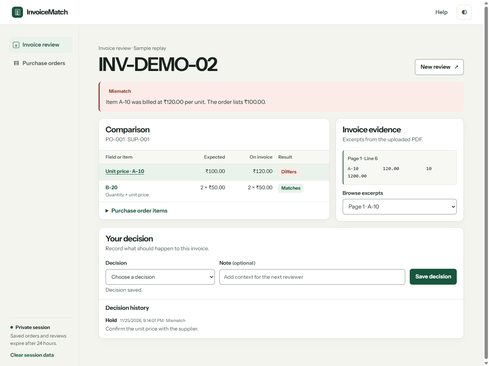
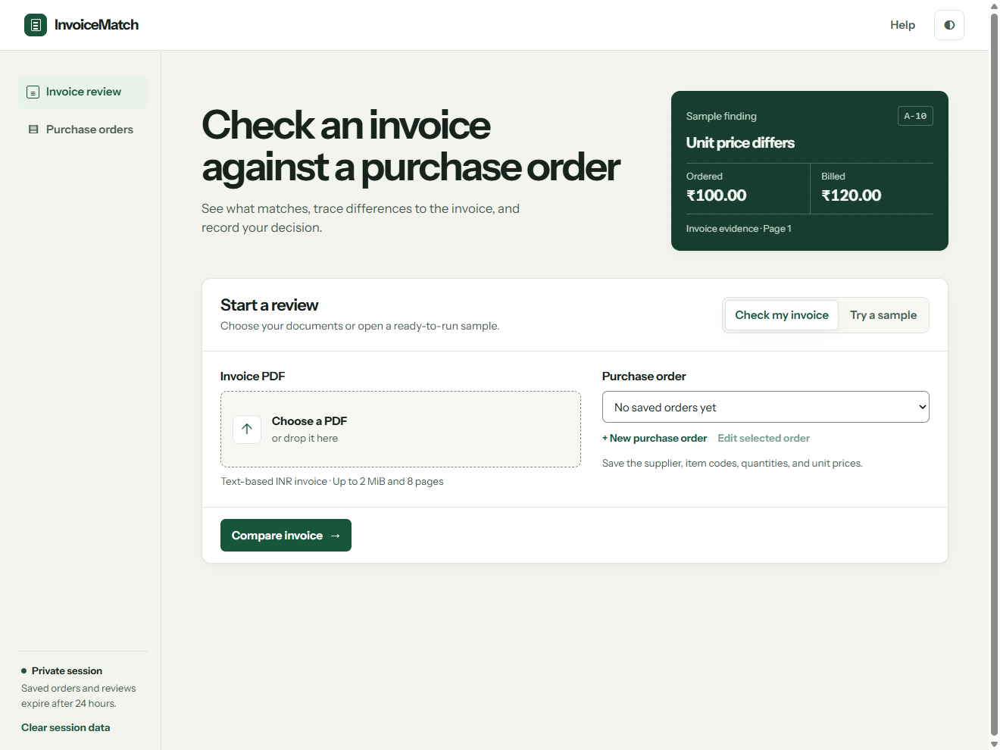

# InvoiceMatch

InvoiceMatch helps accounts payable reviewers check an invoice against a purchase order. It shows what was ordered, what was billed, and the PDF excerpts behind flagged values. Reviewers can record an **Accept**, **Reject**, or **Hold** decision with a note.

**[Try the live demo ↗](https://invoicematch-inky.vercel.app/)** · [Release v0.1.0](https://github.com/RenoX23/invoicematch-document-ai/tree/v0.1.0) · [CI for the deployed revision](https://github.com/RenoX23/invoicematch-document-ai/actions/runs/45644562627)



*The price mismatch sample shows the discrepancy, the invoice evidence, and the reviewer’s decision in one view.*

## Try it

1. Open the live demo and select **Try a sample → Price mismatch → Compare invoice**.
2. Click **Unit price · A-10** to see where the ₹120.00 price appears in the invoice.
3. Save a decision, then refresh to see it in the decision history.

To try your own documents, select **Check my invoice**, create or choose a purchase order, and upload an invoice. The reviewer supports one text-based INR invoice against one purchase order, up to **2 MiB and 8 pages**. Scans and unclear layouts can require manual review.



## How it works

- **Read the invoice.** Extract supplier, items, quantities, prices, and totals from the PDF with page and line references.
- **Compare against the order.** Check the invoice using exact decimal arithmetic and explain mismatches or values that need review.
- **Keep the decision.** Save the purchase order version and review history. Repeating the same upload with the same order and settings opens its existing review.

FastAPI serves the UI and API. The hosted app runs on Vercel with Neon PostgreSQL. The Docker setup uses SQLite. Custom invoices use rules and their contents stay within the reviewer backend. **Live AI** is available for bundled samples. Session access expires after 24 hours, and **Clear session data** clears it early.

## Paired extraction benchmark

Rules and Groq GPT-OSS 20B were evaluated on the same **12 synthetic PDFs** with the same matching policy. Both matched **140 of 140 labeled fields**, reached the same decisions, and marked **0 of 6 discrepancies** as matches. Rules stay the default because the model produced no improvement on this set. The sample is small and covers two layouts. [Frozen labels](tests/fixtures/phase2/labels.json) · [Recorded Groq run](benchmarks/phase2-groq.json)

## Run the local reviewer

```sh
docker compose up --build
```

Open [localhost:8000](http://127.0.0.1:8000/). Sample replay and custom PDF review work without an API key. To enable **Live AI** for samples, set `GROQ_API_KEY` in your environment or local `.env`.

<details>
<summary>Tests and benchmark replay</summary>

With Python 3.11 or newer and an active virtual environment:

```sh
python -m pip install -e ".[dev]"
python -m pytest
python -m ruff check .
python -m ruff format --check .
python -m mypy src asgi.py
python -m invoicematch.benchmark --mode replay --capture benchmarks/phase2-groq.json
```

CI runs the workflow tests on SQLite and PostgreSQL. Set `INVOICEMATCH_TEST_POSTGRES_URL` to a disposable database to include the PostgreSQL cases in a local run.

</details>

<details>
<summary>Deployment and rollback</summary>

1. Deploy the repository to Vercel using the FastAPI preset and `asgi.py`. Connect a Neon database in the same region, with separate branches for preview and production.
2. Set `INVOICEMATCH_MIGRATION_URL` to the direct Neon URL for the target branch and run `python -m invoicematch.migrate` after installing the package. Repeat for each branch.
3. In Vercel, set the pooled Neon URL as `DATABASE_URL`, enable sample-only Live AI with `GROQ_API_KEY`, and set `CRON_SECRET` for daily cleanup. Keep Neon’s TLS and channel-binding parameters in both URLs.
4. Verify `/health`, sample replay, a custom invoice, and a saved decision on the deployed app. To roll back, restore a prior verified Vercel deployment and recheck the workflow against the same database.

</details>

## Phases

The local reviewer, evaluation, and public release are complete. Release `v0.1.0` runs commit `17ebbd1`. Hosted checks covered custom invoices, a live Groq sample, session isolation, and a saved decision across redeploy. Independent Scrutiny checked the public price mismatch against the source PDF. The maintenance phase covers a tested follow-up fix and redeploy.
